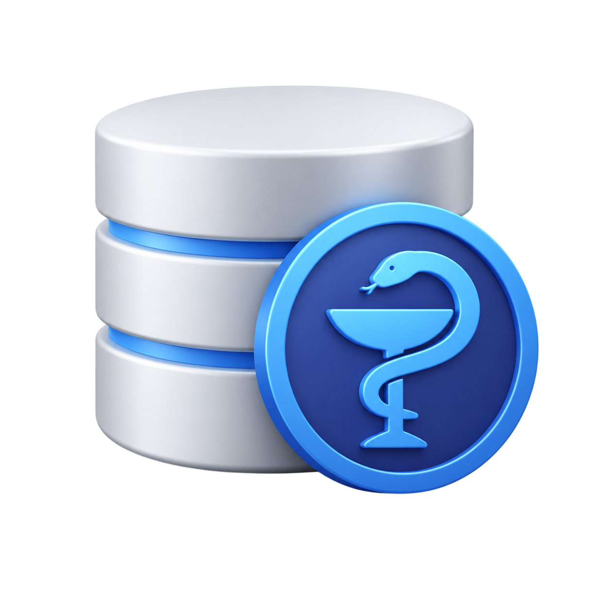

# MED-CMS (v1.1.0)

> ## `med-cms` — Это автономный медецинский движок для управления сетями клиник, персоналом и расписание приймов и т.д. Написан `med-cms` на node.js с использованием **express**, **sequelize**

<p align="center">
  
</p>

### Модуль поставляется со встроенной базой данных, системой разграничения прав доступа на основе **34 медицинских специальностей** и готовым веб-интерфейсом (АРМ Врача, Личный Кабинет Пациента, Панель Суперадминистратора), а также готовой главной страницей

---

## Ключевые возможности

- **Автономность** База данных SQLite3 не требует установки тяжелых серверов (PostgreSQL/MySQL/MongoDB). Файл БД и таблицы создаются автоматически прямо в папке проекта.
- **Безопасность и Сессии:** Авторизация реализована через зашифрованные JWT-токены, хранящиеся в защищенных **HttpOnly Cookie**. JS на клиенте не имеет доступа к токену.
- **Матрица прав доступа (34 специальности):** Гибкое разграничение возможностей врачей. Стоматолог или Эндокринолог не смогут получить доступ к эндпоинтам назначения нейрохирургических операций — то-есть не к своим данным
- **Автоматический расчет участков:** При регистрации или изменении адреса проживания пациента система сама вычисляет номер его терапевтического участка и закрепленный кабинет врача. Участки настраиваются админом.
- **Статистика болезней и МКБ-10:** Выделенный независимый справочник заболеваний в базе данных с возможностью автономной миграции и автоматическим инкрементом счетчиков заболеваемости при закрытии приемов врачами.
- **Возможность управлять новостями** А админ панеле есть форма позволяющая выкладывать новости.
- **Автозапись в `.env`** При запуске проекта код проверяет есть ли `.env` и настройки в нём, если то записывает настройки в него.

---

## Установка и быстрая настройка

### 1. Установка модуля

#### Установите пакет в ваше Node.js приложение:

```bash
npm install med-cms
# или
yarn add med-cms
```

> **Важно для пользователей Linux:** Пакетам `sequelize` и `sqlite3` иногда требуются компиляторы C++ для сборки бинарных файлов под вашу архитектуру ядра. Перед развертыванием убедитесь, что в системе установлены базовые утилиты сборки:
>
> ```bash
> sudo apt update && sudo apt install -y build-essential python3
> ```

### 2. Подключение в Express

#### Для интеграции CMS в ваш Express-сервер импортируйте функцию инициализации и передайте туда ваш инстанс `app`:

```javascript
const express = require("express");
require("dotenv").config();

const app = express();

// Импортируем инициализатор нашего npm-модуля
const MI = require("med-cms");

// здесь ваши роуты ...
app.get("/", async (req, res) => {
  res.end("HELLO!");
});

(async function startServer() {
  // Запускаем медицинский движок med-cms
  // требуется асинхронность из-за запросов в к бд
  await MI(app);

  app.listen(3000, () => {
    console.log(`Сервер успешно запущен!`);
  });
})();
```

---

## Миграция расширенного справочника болезней (РБ)

### Справочник заболеваний полностью изолирован от кода ядра CMS. Для наполнения пустой таблицы `Diseases` актуальными и социально значимыми кодами МКБ-10 для Республики Беларусь, запустите команду миграции перед стартом основного сервера:

```bash
node node_modules/med-cms/migrate-diseases.js
# или
node node_modules\med-cms\migrate-diseases.js
```

### Это наполнит отдельную таблицу базы данных 18 распространенными диагнозами (ОРВИ, Острый бронхит, Внебольничная пневмония, Артериальная гипертензия, Остеохондроз, Эндемический зоб и др.), которые автоматически начнут подтягиваться в HTML-тег `<select>` на рабочем месте врача.

---

## Роли и Маршрутизация (API & Web)

### Архитектура роутера жестко разделяет отдачу интерфейсов и данных, исключая ошибки парсинга `JSON.parse` в браузере:

- **Интерфейс (Web-страницы):** `http://localhost:3000/med/...`
- **Данные (JSON API):** `http://localhost:3000/med/api/...`

### Матрица маршрутов

| Действие                     | Метод | Маршрут (URL)                             | Доступ (Роль) |
| :--------------------------- | :---- | :---------------------------------------- | :------------ |
| Страница авторизации и входа | `GET` | `/med/html/login.html` (или `/med/login`) | Публичный     |
| Главная страница             | `GET` | `/med/html/home.html` (или `/med/home`)   | Публичный     |

---

### Алгоритм проведения инициялизации:

1. Выполните миграцию справочника болезней: `node node_modules/med-cms/migrate-diseases.js` или `node node_modules\med-cms\migrate-diseases.js`.
2. Откройте браузер на `http://localhost:3000/med/home` и нажмите на кнопку **`вход`**.
3. Авторизируйтесь (заполните поля почты и пароля) (данные можно узнать в настройках `.env`)
4. В левой форме добавьте поликлинику. Она запишется в SQLite под числовым `ID: 1`.
5. Кликните на карточку «Всего клиник», чтобы развернуть интерактивную таблицу и проверить числовой ID.
6. В правой форме зарегистрируйте аккаунт врача, выбрав созданную поликлинику №1 из выпадающего списка.
7. Выйдите из админки, нажмите «Зарегистрироваться как пациент» и создайте профиль.
8. В кабинете пациента выберите созданного врача, дату, время и нажмите **«Забронировать талон»**. Талон мгновенно отобразится в блоке предстоящих приемов.
9. Авторизуйтесь под созданным врачом. Пациент появится в вашей очереди. Нажмите «Принять», заполните жалобы, выберите из подгрузившегося справочника диагноз _«Острый бронхит»_ и закройте прием. Системные счетчики зафиксируют визит, а статистика болезни обновится в SQLite.
10. Также можете с аккаунта админа настроить участки и новости!

---

## Лицензия

### Проект распространяется на условиях открытой лицензии [**ISC**](LICENSE.txt). Разработано [RPM-programmer](https://github.com/RPM-programmer/) для создания масштабируемых и отказоустойчивых медицинских информационных систем.
